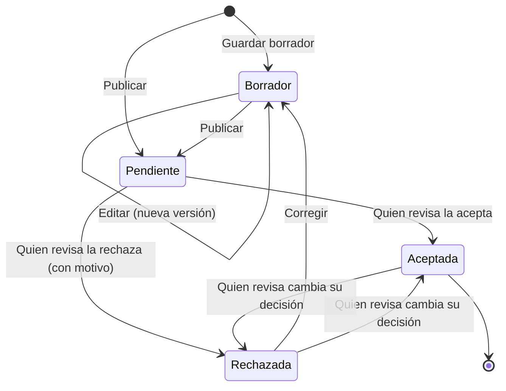

# 1. Introducción y conceptos clave

[← Volver al índice](../README.md)

## ¿Qué es Evidentia?

Evidentia es la herramienta con la que se documenta el trabajo de cada estudiante en las Jornadas InnoSoft Days. Cada persona registra en ella lo que ha hecho (sus **evidencias**), adjunta pruebas y las envía a revisión. Los coordinadores de comité validan ese trabajo, los secretarios levantan acta de las reuniones y el profesorado obtiene al final un cómputo de horas por estudiante.

Todo lo que se registra en Evidentia forma parte de la evaluación de la asignatura. Por eso es importante conocer cómo funciona, qué plazos hay y qué se espera de cada rol.

## Comités

Las jornadas se organizan en **comités**. Cada comité tiene un nombre y un icono, y normalmente cuenta con un **coordinador** (que valida las evidencias dirigidas a ese comité) y un **secretario** (que gestiona sus reuniones y bonos).

Por defecto existen estos comités, aunque el profesorado o la presidencia pueden crear, renombrar o eliminar comités:

| Comité |
|---|
| Presidencia |
| Secretaría |
| Programa |
| Igualdad |
| Sostenibilidad |
| Finanzas |
| Logística |
| Comunicación |
| I+D+I |

El comité **Presidencia** es especial: sus evidencias las revisa la presidencia de las jornadas y no se puede eliminar.

Cada evidencia se asocia a **un** comité. Una misma persona puede enviar evidencias a distintos comités.

## Evidencias

Una **evidencia** es la unidad básica de trabajo en Evidentia. Describe una tarea concreta que has realizado y consta de:

- un **título**,
- las **horas** (y minutos) dedicadas,
- el **comité** al que va dirigida,
- una **descripción** detallada, y
- opcionalmente, **pruebas adjuntas** (documentos, imágenes, archivos comprimidos...).

Una evidencia pasa por varios estados a lo largo de su vida:

| Estado | Significado |
|---|---|
| **Borrador** | Solo la ves tú. Puedes editarla cuantas veces quieras. No cuenta horas. |
| **Pendiente** | Ya la has publicado y está en la cola de revisión. No se puede editar mientras espera. No cuenta horas todavía. |
| **Aceptada** | Se ha validado. **Sus horas se suman a tu cómputo.** |
| **Rechazada** | Se ha rechazado con un motivo. Puedes corregirla y publicarla de nuevo. No cuenta horas. |

Solo las evidencias **aceptadas** cuentan para las horas.

### Quién revisa cada evidencia

| Evidencia | La revisa |
|---|---|
| Dirigida a un comité cualquiera | El coordinador de ese comité |
| Escrita por un coordinador para **su propio** comité | La presidencia |
| Dirigida al comité **Presidencia** | La presidencia |
| Publicada por un presidente | Nadie: queda **aceptada** al publicarla |

Nadie puede revisar su propia evidencia. El profesorado puede revisar cualquier evidencia.

## Horas computadas

Evidentia calcula automáticamente el total de horas de cada estudiante como la suma de cuatro fuentes:

| Fuente | Quién la registra | Cómo se obtiene |
|---|---|---|
| **Evidencias** | El propio estudiante | Suma de las horas de tus evidencias **aceptadas** |
| **Reuniones** | El secretario del comité | Duración de las reuniones en cuya acta apareces como asistente |
| **Asistencia** | El coordinador de registro (desde Eventbrite o a mano) | Duración de los eventos en los que constas como **asistido** (check-in realizado) |
| **Bonos** | El secretario del comité | Bonos de horas que un secretario te haya asignado |

Este desglose aparece, con una barra por origen, en tu página de **Inicio** y en **Mi perfil**. Es el mismo cómputo que el profesorado exporta al final de las jornadas.

## Plazos (fechas límite)

El profesorado o la presidencia configuran cinco fechas límite para el curso. Se muestran en la tarjeta **Plazos** de la página de inicio y, en cada sección, en una tarjeta con cuenta atrás al pie del menú lateral. Unos días antes de que cierren los plazos de subida, validación y reuniones, Evidentia envía un **recordatorio** a quienes les afecta (ver [Avisos](02-acceso-y-perfil.md#avisos)).

| Plazo | Qué ocurre cuando vence |
|---|---|
| **Subida de evidencias** | Ya no se pueden crear, editar, corregir, cambiar de comité ni borrar evidencias. Solo consultarlas. La opción *Nueva evidencia* desaparece del menú. |
| **Validación de evidencias** | Los coordinadores y la presidencia ya no pueden aceptar ni rechazar evidencias. |
| **Registro de reuniones** | Los secretarios ya no pueden crear, editar ni borrar actas. |
| **Registro de bonos** | Los secretarios ya no pueden crear, editar ni borrar bonos de horas. |
| **Importación de eventos y asistencias** | El coordinador de registro ya no puede cargar eventos ni asistencias desde Eventbrite. |

> **Consejo:** no apures los plazos. Una evidencia rechazada el último día no se podrá corregir a tiempo, y una revisión hecha con prisas puede contener errores.

## Sellos de integridad

Cada evidencia y cada archivo adjunto reciben, al guardarse, un **sello** calculado a partir de su contenido. La presidencia y el profesorado disponen de una herramienta para comprobar que ninguna evidencia ni prueba ha sido manipulada después de su registro. Como usuario no tienes que hacer nada: el sello se genera y se comprueba automáticamente.

## Trazabilidad

Evidentia anota en un **registro de actividad** las acciones importantes: envíos y revisiones de evidencias, actas, bonos, cambios de roles, accesos, etc. Cada persona puede consultar las suyas en **Mi actividad**, y cada evidencia, acta y convocatoria tiene su propio **Historial**. Los coordinadores y secretarios ven la actividad de su comité, y la presidencia y el profesorado el registro completo.

## Versión de la aplicación

La versión del software en uso (por ejemplo, `v4.0.1`) aparece en el pie de todas las páginas.
