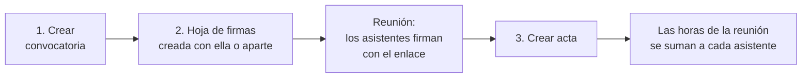

# 6. Guía del secretario de comité

[← Volver al índice](../README.md)

Como secretario, documentas la **actividad de tu comité**: convocas las reuniones, recoges las firmas de asistencia, levantas las actas y, cuando procede, registras **bonos de horas**. Las horas de reunión y los bonos que registras se suman directamente al cómputo de cada estudiante, por lo que tu trabajo tiene efecto directo en la evaluación.

Todo lo que necesitas está en el bloque **Reuniones y bonos** del menú lateral:

- **Reuniones**
- **Bonos**
- **Listas**
- **Mensajes** y **Actividad del comité** (si no los ves ya en el bloque **Comité** por ser también coordinador).

En el móvil, la barra inferior te da acceso directo a **Inicio**, **Reuniones**, **Bonos**, **Listas** y **Perfil**. Tus propias evidencias las gestionas desde **Mis cosas** ([capítulo 4](04-estudiante.md)).

## El ciclo de una reunión

**Reuniones** tiene cuatro pestañas:

| Pestaña | Contenido |
|---|---|
| **Resumen** | Las cifras de **Convocatorias** (y cuántas quedan por celebrar), **Hojas de firmas** (y cuántas firmas suman) y **Actas** (y cuántas horas registran), las **Próximas convocatorias** y las **Últimas actas**. |
| **Convocatorias** | Tus convocatorias. |
| **Hojas de firmas** | Tus hojas de firmas. |
| **Actas** | Tus actas. |

En la cabecera tienes **Nueva convocatoria**, **Nueva hoja de firmas** y, mientras el plazo de registro de reuniones esté abierto, **Nueva acta**.

Los tres elementos son independientes: puedes levantar un acta sin convocatoria ni hoja de firmas. Pero si sigues el orden completo, el acta se rellena sola con los datos de la convocatoria y con las firmas recogidas.

## 1. Convocatorias

Una **convocatoria** anuncia una reunión y fija su orden del día. Evidentia genera un **PDF** con el formato oficial de las jornadas que puedes descargar y distribuir. La reunión aparece además en el bloque **Próximas reuniones** del panel principal, y la coordinación y la secretaría de tu comité, y quienes tienen evidencias enviadas a él, reciben un aviso.

### Crear una convocatoria

1. **Reuniones → Nueva convocatoria**.
2. Rellena el formulario:

   | Campo | Indicaciones |
   |---|---|
   | **Título** | Entre 5 y 255 caracteres. |
   | **Fecha** y **Hora** | La fecha no puede ser anterior a hoy. |
   | **Lugar** | Entre 5 y 255 caracteres (aula, enlace de videollamada...). |
   | **Tipo** | *Ordinaria* o *Extraordinaria*. |
   | **Modalidad** | *Presencial*, *Telemática* o *Híbrida*. |
   | **Orden del día** | Escribe cada punto en **Añade un punto** y pulsa **Añadir** (hasta 50 puntos). Reordénalos con los botones **Subir** y **Bajar** (o con Alt y las flechas) y quítalos con **Quitar**, que pide confirmación. |
   | **Crear su hoja de firmas** | Activado por defecto: crea una hoja de firmas vinculada a la convocatoria (recomendado). |

3. Pulsa **Crear convocatoria**.

### La lista de convocatorias

La pestaña **Convocatorias** muestra las columnas **Convocatoria**, **Programada**, **Hoja de firmas** (*Con hoja* o *Sin hoja*) y **Modificada**. Para cada una puedes:

- Ver su **Historial**: el orden del día, las firmas recogidas, los datos y los cambios.
- **Descargar el PDF** de la convocatoria.
- **Editar** (título, fecha, hora, lugar, tipo, modalidad y orden del día) y pulsar **Guardar convocatoria**. El PDF se regenera.
- **Eliminar**. La ventana **«Eliminar la convocatoria»** te recuerda que *«Su hoja de firmas se conserva sin convocatoria y ningún acta cambia.»*

## 2. Hojas de firmas

Una **hoja de firmas** es la forma de registrar quién asiste a una reunión. Cada hoja tiene una **URL única** del tipo `https://evidentia.us.es/sign/1234`; los asistentes la abren, se identifican con su correo y contraseña de Evidentia y su firma queda registrada con fecha y hora.

### Crear una hoja de firmas

Si dejaste activado **Crear su hoja de firmas** al crear la convocatoria, la hoja ya existe (con el título «Hoja de firmas de <título de la convocatoria>»). Si no:

1. **Reuniones → Nueva hoja de firmas**.
2. Escribe un **Título** (entre 5 y 255 caracteres).
3. Opcionalmente, elige la **Convocatoria**. Solo aparecen las convocatorias que aún no tienen hoja; puedes dejar *Sin convocatoria*.
4. Pulsa **Crear hoja de firmas**.

### Durante la reunión

1. Abre la pestaña **Hojas de firmas** y localiza la hoja. Debajo de su título verás el enlace, y en su fila un icono para **copiarlo**.
2. Comparte el enlace con los asistentes (proyectándolo, por el chat de la videollamada, por el grupo del comité...).
3. Cada asistente firma desde su dispositivo. Tú no necesitas firmar: se te incluye automáticamente como asistente al levantar el acta.

Puedes seguir las firmas en tiempo real abriendo la hoja: la tabla **Firmas** muestra a cada **Persona** con su **UVUS** y la fecha y hora exactas en que firmó (**Firmada**). La tarjeta **Enlace para firmar** tiene el botón **Copiar enlace**.

### Editar y eliminar

- **Editar**: cambiar el **Título** o la **Convocatoria** y pulsar **Guardar hoja de firmas**.
- **Eliminar**: la ventana **«Eliminar la hoja de firmas»** te recuerda que *«Se borrarán sus firmas para siempre. Su convocatoria y las actas no cambian.»*

> El enlace de firma funciona mientras exista la hoja. Si quieres evitar firmas fuera de la reunión, levanta el acta al terminar y, si procede, elimina la hoja después.

## 3. Actas

El **acta** es el documento que registra oficialmente la reunión: quién asistió, cuánto duró, qué se trató y qué **acuerdos** se tomaron. Al crearla, Evidentia:

- registra la **reunión** con su duración, y **suma esas horas a cada asistente** (aparecen en su cómputo y en su lista *Mis reuniones*), que recibe un aviso;
- genera un **PDF** del acta con el formato oficial, que puedes descargar desde la pestaña **Actas** y que la presidencia y el profesorado también pueden consultar.

> Solo puedes crear, editar o eliminar actas mientras el plazo de **registro de reuniones** esté abierto. Después, la lista y los PDF siguen disponibles.

### Crear un acta (asistente de tres pasos)

**Reuniones → Nueva acta**. Arriba verás los tres pasos: **Convocatoria**, **Hoja de firmas** y **Redacción**.

**Paso 1: Convocatoria.** Elige la convocatoria de la reunión (o *Sin convocatoria*) y pulsa **Siguiente**. Si la eliges, el formulario del paso 3 se rellenará con sus datos y su orden del día.

**Paso 2: Hoja de firmas.** Si la convocatoria tiene su propia hoja, se usa esa. Si no, elige la **Hoja de firmas** de la reunión (o *Sin hoja de firmas*). Las personas que firmaron se volcarán como asistentes en el paso 3. Pulsa **Siguiente** (o **Anterior** para volver).

**Paso 3: Redacción.** Revisa y completa el formulario:

| Sección | Indicaciones |
|---|---|
| **Reunión** | **Título** y **Lugar** (entre 5 y 255 caracteres), **Fecha**, **Hora**, **Tipo** y **Modalidad**, precargados desde la convocatoria si la elegiste. |
| **Duración** (**Horas** y **Minutos**) | Duración real de la reunión. Rellena al menos uno; horas hasta 99 y minutos hasta 60. **Estas son las horas que recibirá cada asistente.** |
| **Asistencia** | El selector **Asistentes**, precargado con las firmas. Puedes buscar personas por nombre o apellidos y quitarlas. También puedes elegir una **Lista predeterminada** y pulsar **Cargar** (ver [Listas predeterminadas](#listas-predeterminadas)). Debe haber al menos una persona. |
| **Desarrollo** | El editor **Puntos y acuerdos**, precargado con el orden del día de la convocatoria. Cada punto tiene **Título**, **Descripción** de lo tratado, **Duración (min)** y sus **Acuerdos** (**Añadir acuerdo** para cada uno). Con **Añadir punto** incluyes puntos no previstos; **Subir**, **Bajar** y **Quitar** funcionan como en el orden del día. |

Pulsa **Crear acta** para terminar.

Cada acuerdo recibe un **identificador único** con el formato `ISD-<fecha>-<comité>-<reunión>-<punto>-<acuerdo>`, que aparece en el PDF y sirve para referirse a él en reuniones posteriores.

### El PDF del acta

El acta generada incluye un panel con los **datos de la reunión** (fecha, horario calculado a partir de la duración, tipo, modalidad, lugar y secretaría), los **asistentes** que marcaste en el acta, una sola vez cada uno y por apellidos, con la etiqueta *Coordinación* o *Secretaría* si tienen ese cargo en el comité, el **orden del día**, el **desarrollo** de cada punto con su duración, su descripción y sus acuerdos con identificador, y el **cierre** con la firma de la secretaría.

En la **Descripción** de un punto y en el texto de cada acuerdo puedes dar formato sencillo, que se respeta en el PDF y en la página del acta:

- una línea en blanco separa párrafos;
- las líneas que empiezan por `- ` forman una lista, y las que empiezan por `1. `, `2. `... una lista numerada;
- `**texto**` pone el texto en negrita y `*texto*` en cursiva.

Los PDF de actas y convocatorias se generan de nuevo cada vez que se descargan, así que siempre salen con el diseño actual, también los de reuniones antiguas.

### La lista de actas

La pestaña **Actas** muestra las columnas **Reunión**, **Duración**, **Celebrada** y **Modificada**. Para cada una puedes:

- Ver su **Historial**.
- **Descargar el PDF**.
- **Editar** (con el plazo abierto): se abre la página **Editar acta** con los mismos campos del paso 3. Al pulsar **Guardar acta** se sustituyen los asistentes, los puntos y los acuerdos y se vuelve a generar el PDF. Los acuerdos cuyo punto y texto no cambian conservan su identificador; los demás reciben uno nuevo con la fecha de la edición.
- **Eliminar** (con el plazo abierto): la ventana **«Eliminar el acta»** te recuerda que *«Se borrarán el acta, su PDF, la reunión con sus asistencias, los puntos y los acuerdos. La convocatoria y la hoja de firmas no cambian.»* Los asistentes pierden esas horas.

## Bonos de horas

Un **bono** permite asignar horas adicionales a uno o varios estudiantes por trabajo que no encaja en evidencias, reuniones ni eventos (por ejemplo, una tarea colectiva reconocida por el comité). Las horas del bono se suman al cómputo de cada persona.

> Usa los bonos con criterio y siguiendo las indicaciones del profesorado: son horas que no pasan por la validación de un coordinador.

### Crear un bono

1. **Bonos → Nuevo bono**.
2. Rellena:

   | Campo | Indicaciones |
   |---|---|
   | **Motivo** | Entre 5 y 255 caracteres. |
   | **Horas** | Entre 0,5 y 99,99. Admite decimales. |
   | **Personas** | Una o más personas de tu comité. Puedes cargar a los miembros de una **Lista predeterminada**. |

3. Pulsa **Guardar bono**.

Solo puedes dar bonos a quien trabaja en tu comité, es decir, a quien ha enviado alguna evidencia a tu comité, ha asistido a alguna de sus reuniones o lo coordina o lleva sus actas. El profesorado nunca recibe bonos. Si una lista incluye a alguien de fuera, no se carga. Al editar un bono, quien ya estaba en él puede seguir aunque ya no cumpla la condición.

La lista **Bonos** muestra las columnas **Bono**, **Personas** y **Horas**, y en la cabecera el plazo de **Registro de bonos**. Mientras está abierto puedes **editar** y **eliminar** bonos; al eliminar, la ventana **«Eliminar el bono»** te recuerda que *«Se borrarán las horas que el bono da a sus personas.»* Después de esa fecha no se pueden crear, editar ni borrar.

## Listas predeterminadas

Una **lista** es un conjunto de personas guardado con un nombre (por ejemplo, «Miembros del comité de Logística»). Sirve para no tener que seleccionar una a una a las mismas personas cada vez que levantas un acta o creas un bono.

- **Listas → Nueva lista**: escribe un **Nombre** (hasta 255 caracteres), elige a las **Personas** (al menos una) y pulsa **Guardar lista**.
- La lista **Listas** muestra las columnas **Lista**, **Personas** y **Creada**. Desde ella puedes **editar** y **eliminar** tus listas (la ventana **«Eliminar la lista»** avisa de que no se puede deshacer).
- En los formularios de **acta** y de **bono** aparece el desplegable **Lista predeterminada**. Elige una y pulsa **Cargar**; al confirmar con **Sustituir**, sus miembros reemplazan la selección actual, que aún puedes ajustar.

## Avisos que recibirás

- Cada evidencia enviada a revisión a tu comité.
- Un recordatorio antes de que cierre el plazo de registro de reuniones, si tienes convocatorias ya celebradas que aún no tienen acta.

## Plazos que te afectan

| Plazo | Efecto |
|---|---|
| **Registro de reuniones** | Cuando vence, no se pueden crear, editar ni eliminar actas. Las convocatorias y las hojas de firmas no dependen de este plazo. |
| **Registro de bonos** | Cuando vence, no se pueden crear, editar ni eliminar bonos. |

## Lista de comprobación

- [ ] Cada reunión celebrada tiene su **acta** levantada con la duración correcta y todos los asistentes, antes del cierre del registro de reuniones.
- [ ] He descargado los PDF de convocatorias y actas para el archivo del comité.
- [ ] Los **bonos** están registrados antes de la fecha límite.
- [ ] He eliminado las hojas de firmas que ya no deben admitir firmas (opcional).
